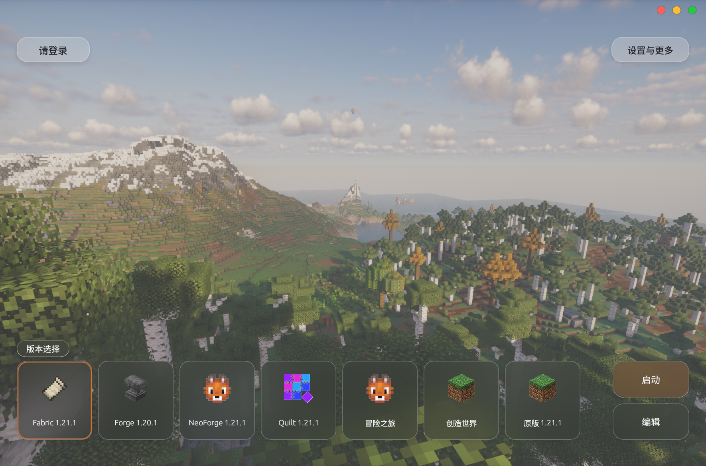
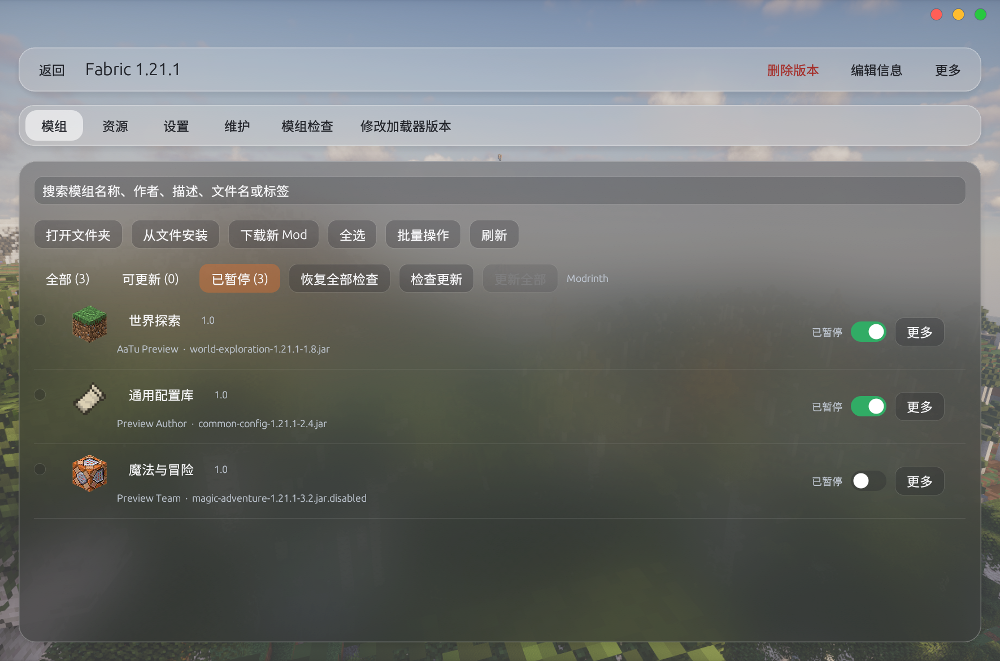
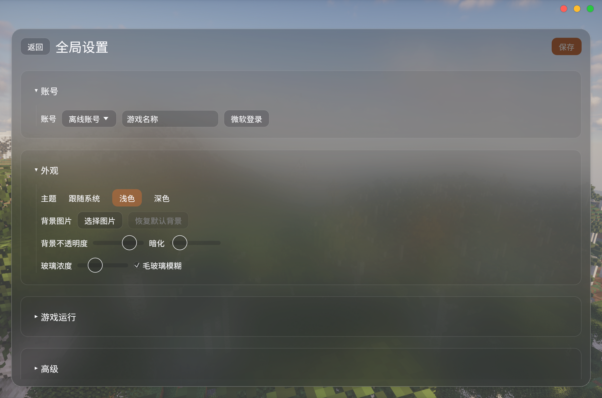
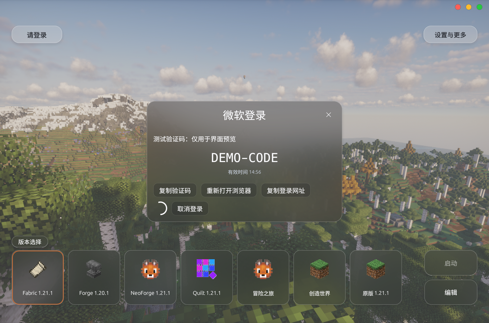

# AaTuLauncher

AaTu 是使用 Rust 编写的 Minecraft Java 版桌面启动器，采用毛玻璃界面和无边框窗口。

## 主要功能

- 管理已有游戏目录和多个实例，安装游戏与加载器。
- 通过微软验证码流程登录账号，或使用本地离线账户。
- 显示模组图标、作者和文件名，支持单项及批量启停。
- 检查 Modrinth 兼容更新，在启动器内下载并更新模组。
- 按实例保存暂停更新名单，支持单项、批量暂停及恢复检查。
- 管理资源包、光影和存档，导入及导出整合包。
- 自定义背景、主题和毛玻璃效果。

## 界面预览

以下图片截取自 AaTu 原生界面。实例、模组及作者名称使用演示数据，登录窗口中的 `DEMO-CODE` 为示例验证码。

### 首页

版本卡片支持横向滚动，选中实例后可启动或编辑。

### 模组管理

模组启用开关与暂停更新分别控制。“已暂停”页签集中显示当前实例的暂停名单。

### 全局设置

账号、主题与背景设置采用独立页面。

### 微软验证码登录

点击“微软登录”后，启动器获取并复制验证码，打开微软验证网页。用户在网页完成授权后，启动器继续处理 Minecraft 登录。

## Microsoft 与 Minecraft API 用途

AaTu 使用 Microsoft 设备码授权流程，由用户在微软网页完成账号验证。随后通过 Xbox Live、XSTS 与 Minecraft 服务获取游戏登录凭据、核验 Minecraft Java 版授权，并读取玩家名称、UUID 和皮肤，用于账号显示与游戏启动。

账号令牌通过系统凭据服务保存，配置文件保存账号档案。开发状态和待验证事项见 [NEKO.MD](NEKO.MD)。

## 技术信息

- 语言：Rust。
- 原生界面：egui / eframe。
- 当前构建平台：Windows x64。
